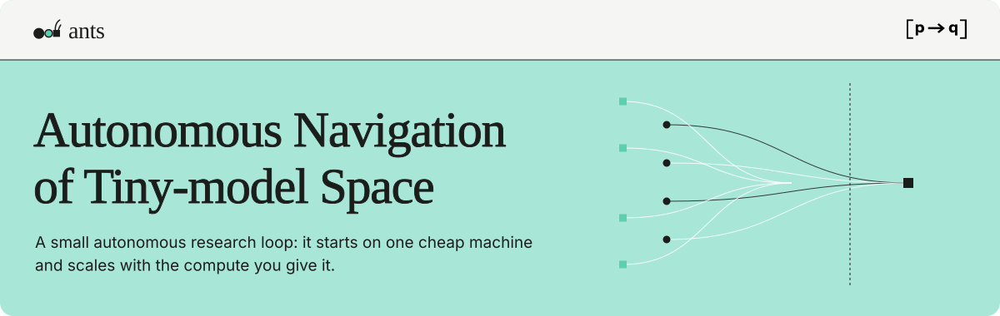
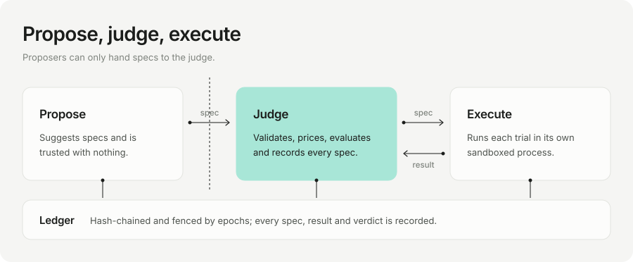
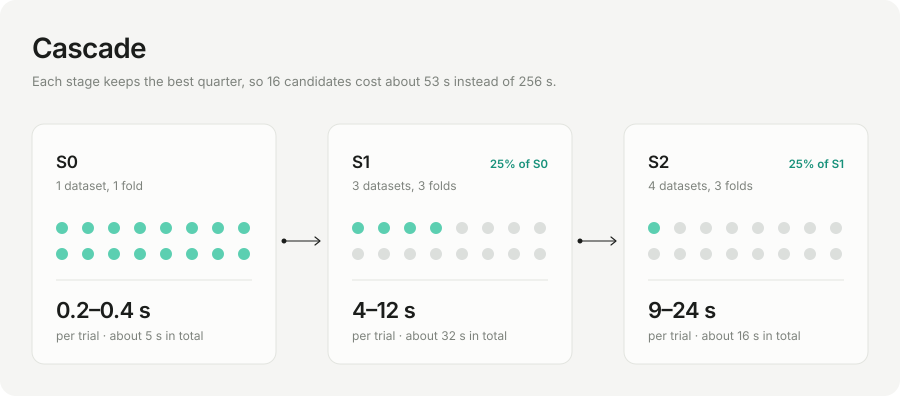
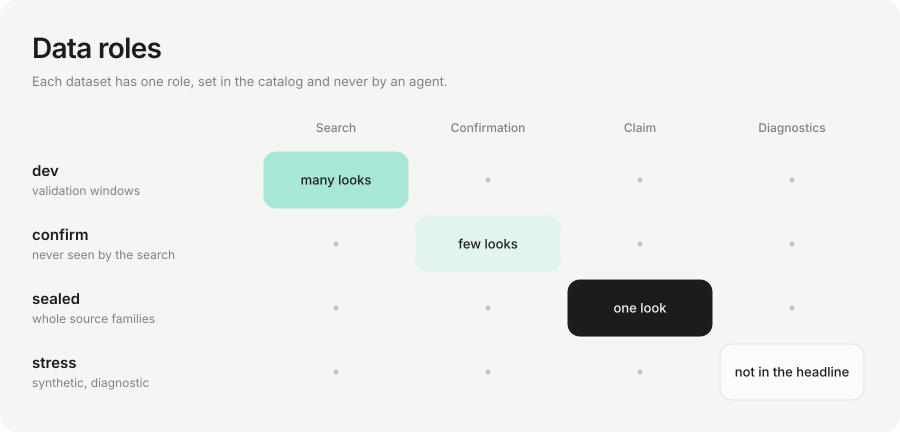
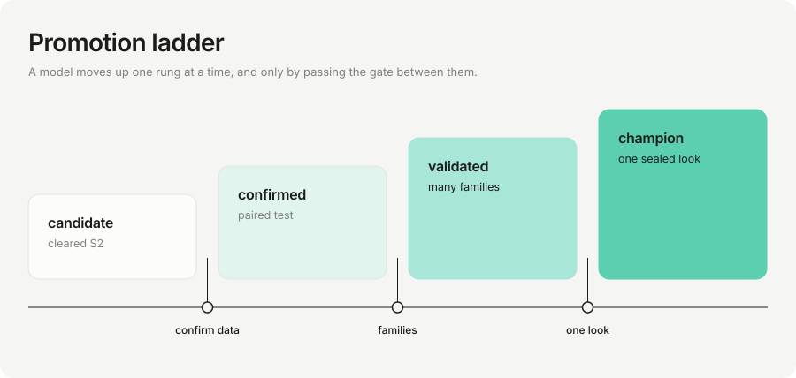
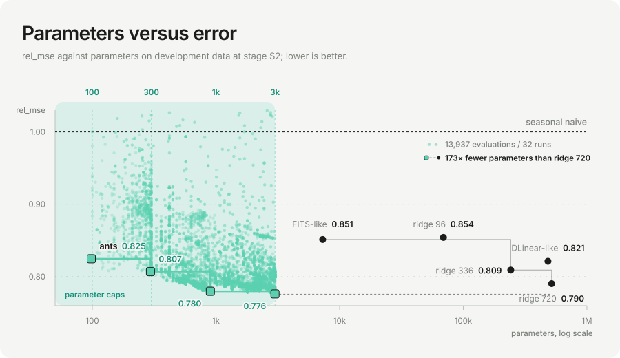
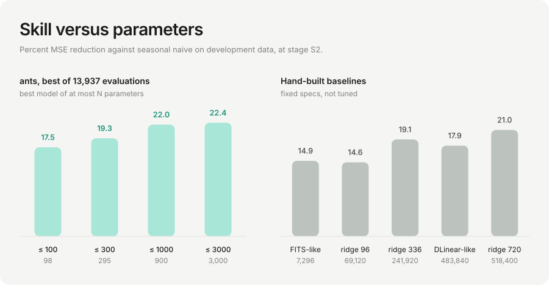
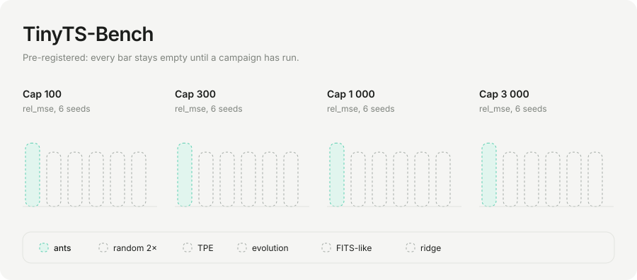

<p align="center"></p>

<p align="center">
<a href="./.github/workflows/ci.yml"></a>
<a href="./LICENSE"></a>
<a href="./pyproject.toml"></a>
<a href="./docs/surfaces.md"></a>
<a href="https://www.npmjs.com/package/ants-lab"></a>
</p>

<p align="center">
<a href="#start-here">Start here</a> · <a href="#news">News</a> · <a href="#how-it-works">How it works</a> · <a href="#development-frontier">Measurement</a> · <a href="#install">Install</a> · <a href="#quick-start">Quick start</a> · <a href="#documentation">Documentation</a> · <a href="#roadmap">Roadmap</a> · <a href="#cite">Cite</a>
</p>

**A small autonomous research loop: it starts on one cheap machine and scales with the compute you give it.**

> I believe a leaf of grass is no less than the journey-work of the stars,
> And the pismire is equally perfect, and a grain of sand, and the egg of the wren.
> — Walt Whitman, *Song of Myself*, §31

A pismire is an ant: no plan, no view of the whole, a trace left for others. ants works the same way. Many small, cheap,
fallible searchers (scripts, search operators, small language models) move through a space of candidate models, and none of them
scores its own work: a fixed evaluator does, and nothing a searcher writes can reach it.

It runs unattended on a 2 vCPU / 2 GB machine, and the same loop grows with the compute you give it ([scaling](docs/scaling.md)).
The first domain is time-series forecasting with models of 100 to 3 000 parameters; the loop does not care what the models are.

<p align="center"></p>

## 0.6.4 research views

Leaderboard now switches between Live and Saved (`v`), with explicit retained-model reasons and saved-weight validation traces (`t`, where locally available). Arms switches to a continuous wireframe search map (`m`), with observed models and recorded ancestry. `o` rotates the view, `z` changes height semantics, `c` switches search/neutral colours, and Enter shows the selected model record. Map and model data share one screen, stacked first; a short, wide terminal uses columns. Health, Data and System place key data and labelled charts together by default (`v` opens full details). System includes a date/hour activity heatmap (`c`: recorded evaluation CPU minutes or completed trials), alongside separate backup receipts. Past keeps dates, questions and pilot arm records in a compact history view.

Map snapshots are built explicitly from verified ledgers; opening the viewer does not train models or rescan experiments. The current map is a retrospective configuration projection, not an online controller or a semantic-distance claim. [Terminal map instructions](docs/modules/search_map.md) and [saved-weight checks](docs/modules/model_validation.md).

## Start here

| I want to | go to |
|---|---|
| see it run | [Quick start](#quick-start) |
| know what ants holds true | [principles](docs/principles.md) |
| see what runs, and how far to trust it | [surfaces](docs/surfaces.md) |
| understand the parts and the words | [architecture](docs/architecture.md) · [glossary](docs/glossary.md) |
| write a gym or a contract | [gyms](docs/gyms.md) · [contracts](docs/contracts.md) |
| use the CLI, or drive it from an agent | [cli](docs/cli.md) · [AGENTS.md](AGENTS.md) |
| run it for weeks on a small server | [operations](docs/operations.md) |
| see the protocol and what is still unknown | [benchmark](docs/benchmark.md) · [open questions](docs/open.md) |
| change something | [CONTRIBUTING](CONTRIBUTING.md) · [changes](docs/changes.md) |

## News

| date | |
|---|---|
| 2026-10-13 | `ants` opens a terminal interface (home, overview, leaderboard, trials, arms side by side, events, health, data, system) with live animation and plain-language status; `ants onboard`, `service`, `backup`, `restore`, `sql`, `update` make it a resident system ([tui](docs/tui.md)). |
| 2026-10-13 | Three searches run on a 2 GB server: no model, a one-shot model operator, and an agent that reads the ledger before it proposes. First eight hours analysed; epoch 2 fixes what they showed ([roadmap](docs/roadmap.md)). |
| 2026-10-13 | Independent audit: 36 findings. Single-instance lock, signal-safe shutdown, an AST patch gate, sealed-look accounting, chain anchors and per-bin promotion evidence are merged. |
| 2026-10-13 | `ants best` now ranks by the deepest stage reached; the first-stage value no longer outranks a deeper one. |
| 2026-10-13 | Cheap-stage fidelity measured: S0 keeps only half of the true top quartile; S1 and S2 agree almost exactly ([open questions](docs/open.md)). |
| 2026-10-13 | TinyTS-Bench protocol written down before any run ([benchmark](docs/benchmark.md)). |

## Look

```
ants tinyts_real · arm portfolio · epoch 9a60d4a9ac35 · chain ok 2de7693a5a93

best per parameter cap (deepest stage reached)
  ≤  300  0.8922 s2  300 params   evo    lookback=248, norm=last, augment=True
  ≤ 1000  0.8706 s2  420 params   sweep  norm=last
  ≤ 3000  0.8460 s2  1190 params  evo    lookback=352, period=22, norm=last, ens=3, ...

search mechanisms (discovery rate)  qd 1.00  sweep 0.67  tpe 0.33  evo 0.25  sa 0.00  de 0.00
```

`ants top` on a 60-trial demo, not a campaign. `rel_mse` below 1 beats seasonal naive. Plain `ants` on a terminal opens the [terminal interface](docs/tui.md).

## How it works

<p align="center"></p>
<p align="center"></p>
<p align="center"></p>

| | most agentic research loops | ants |
|---|---|---|
| who judges | the proposer, or a prompt | code the proposers cannot reach |
| limits | a term in the objective | a constraint on the search: over-limit models never lead |
| language models | the engine | one cheap operator, tested against random search at equal budget |
| failure | an exception | a normal outcome: `kill -9`, full disk, clock jumps |

The eight evaluation layers: [docs/evaluation](docs/evaluation/README.md).

## Development frontier

<p align="center"></p>
<p align="center"></p>

The figures now show the pooled development frontier from **all 32 completed E43 runs** (16 matched seeds, two arms), checked on November 2, 2026: 188,520 finished trials and 13,937 S2 evaluations. Both arms use epoch `5da6eeee6527`. The hand-built reference measurements are retained from the earlier evaluation under the same S2 protocol; they are untuned.

| nominal parameter cap | best recorded parameters | development rel_mse |
|---|---:|---:|
| 100 | 98 | 0.824718 |
| 300 | 295 | 0.806931 |
| 1,000 | 900 | 0.779906 |
| 3,000 | 3,000 | 0.776302 |

**Reading the two figures.** Every plotted value is in [frontier.json](assets/frontier.json). In the first figure, the horizontal axis is the nominal parameter count and the vertical axis is `rel_mse`; lower error is better. The second expresses the same error as skill, `1 − rel_mse`, so higher is better. A `rel_mse` of 0.776302 means a 22.37% reduction in this aggregate error relative to seasonal naive. These are development measurements under stage S2: four development datasets, rolling-origin validation and closed-form forecasters.

* *Skill at a fraction of the reference size.* The best recorded model under 300 parameters uses 295 and reaches `rel_mse` 0.806931. The untuned FITS-like reference uses 7,296 and reaches 0.851375: about 25 times as many nominal parameters, with higher development error.
* *Beyond the largest reference on this development measurement.* The 3,000-parameter candidate reaches 0.776302, compared with 0.790450 for ridge with a look-back of 720 and 518,400 parameters. That is about 173 times fewer nominal parameters. The 900-parameter candidate reaches 0.779906; ridge 336 uses 241,920 at 0.809193 and the DLinear-like reference uses 483,840 at 0.821303. Their nominal sizes are about 269 and 538 times larger. These ratios describe the evaluator's parameter accounting, not total deployed storage or inference cost.
* *Where the curve flattens.* The 98-parameter candidate reaches a 17.53% aggregate error reduction; the 900-parameter candidate reaches 22.01%. Increasing to 3,000 parameters raises that reduction to 22.37%, a further 0.36 percentage points. The observed frontier says where this search found diminishing returns; it does not establish a universal lower bound.
* *Why these comparisons do not establish superiority.* The ants candidates are the best of many trials selected on their scoring data, whereas the references are single untuned settings. Pooling two arms and 16 seeds improves the descriptive coverage but does not remove selection bias. Equal-budget comparisons with tuned references and independent held-out evaluation remain the job of [TinyTS-Bench](#benchmark). No sealed result is inferred from these plots.

These are pooled minima selected on the same development data used for scoring. They include the completed budget-crossing trial and are descriptive model candidates, not independent generalization results or the paired endpoints of E43. Stored deployment weights plus preprocessing can exceed the evaluator's nominal parameter count; the exporter checks actual storage and refuses an over-cap bundle.

**E43 final look:** the registered ≤300-parameter comparison gives a paired median difference of 0 and Wilcoxon p=0.5771 at the prespecified 0.0294 threshold. Screening is not adopted on this evidence. The ≤3,000-parameter improvement is exploratory. See the [final acceptance report](docs/experiments/E43-final-20261102.md).

The [retained research collection](docs/models/E43-shortlist-20261102.md) records ten selected models, their full specifications, reasons and available weight variants. The Saved interface displays this catalog and its explicit development-only weight checks; a fresh installation needs its own catalog or an imported collection.

**What is and is not reproducible from this repository.** Data and per-ledger SHA-256 identities: [frontier.json](assets/frontier.json). Regenerate the displayed figures with `python assets/make_figures.py`. The raw ledgers are backed up privately and are not shipped with this repository; a clone reproduces the figures from the checked-in data, not the full experiment. The public time series are fetched with pinned hashes (`ants data fetch`), rather than committed here. Re-running the search also requires the registered contracts, arm settings, seeds and budgets; reproducing the figures alone does not reproduce the search. Candidate specifications are preserved separately. Refit bundles contain numeric weights, preprocessing, source and parity checks and are labelled as new train-only fits, not historical checkpoints.

## Benchmark

<p align="center"></p>

**TinyTS-Bench** is specified before it is run: arms, seeds, stopping rule and what counts as a null result are in the
[protocol](docs/benchmark.md). Its bars are still empty on purpose. The full protocol is about 120,000 evaluations (about 350 core-hours); the completed E43 screen comparison does not fill those broader benchmark cells. The next registered queue is E44a engineering calibration. A stronger Optuna/random comparison needs its own frozen settings and budget ([next experiment](docs/experiments/E44-calibration-20261102.md)); no unmeasured benchmark number is drawn here.

## Install

| how | command | notes |
|---|---|---|
| npm, installed | `npm install -g ants-lab`, then `ants` | the package is a thin launcher; on first run it builds a private Python environment in `~/.ants` (Python 3.11+ and network needed, about ten seconds) |
| npm, no install | `npx ants-lab doctor` | same launcher, run once |
| from source | `git clone https://github.com/p-to-q/ants` then the steps in [Quick start](#quick-start) | for development, and for real data runs that live in the checkout |

The npm package is [`ants-lab`](https://www.npmjs.com/package/ants-lab) (the bare name `ants` is taken). The command it installs is `ants`.
Versions and how a release is cut: [docs/release.md](docs/release.md). PyPI: not published yet.

## Quick start

**1. Install**

```bash
npm install -g ants-lab                  # or: git clone https://github.com/p-to-q/ants && cd ants && uv pip install -e ".[gyms,search,dev]"
```

**2. Set up**: creates `~/.ants`, downloads the public datasets (every file checked against a pinned hash) and writes the config

```bash
ants onboard
```

**3. Run**

```bash
ants run                                 # in the foreground
ants service install --now               # or keep it running: restarts, watchdog, daily verified backup
ants run --contract tinyts_synth_hard --workdir runs/demo --max-evals 300      # a first look on synthetic data
```

**4. Look at it**

```bash
ants                  # on a terminal: the interface (docs/tui.md); in a pipe: the line shell
ants top              # state, best per cap, operators
ants show 12          # spec, every stage, lineage of one trial
ants diff 5 7         # what differs between two trials
ants sql "SELECT stage, COUNT(*) FROM trials GROUP BY stage"     # read-only
ants doctor           # hash chain, disk, stuck or failing runs, backups
ants backup           # verified snapshot; ants restore puts one back
```

Every read command has `--json` and meaningful exit codes, so another agent can drive the same surface ([AGENTS.md](AGENTS.md)).

**5. Language-model arms** (optional): put `LLM_<TAG>_BASE`, `LLM_<TAG>_KEY` and `LLM_<TAG>_MODEL` in a `chmod 600` env file and use `--arm portfolio_llm`, or `--arm portfolio_agent` for the operator that reads the ledger before it proposes. Keys are never written to the repository, the ledger or a log; model calls are capped per day.

**6. A server**: [operations](docs/operations.md) and `deploy/`. `ants update` checks for a newer version.

## Documentation

| | |
|---|---|
| [Principles](docs/principles.md) | what ants holds true, and where each is enforced |
| [Architecture](docs/architecture.md) · [Glossary](docs/glossary.md) | the parts and the words |
| [Evaluation layers](docs/evaluation/README.md) | eight layers, one question each |
| [Modules](docs/modules/README.md) | one page per module |
| [Contracts](docs/contracts.md) · [Gyms](docs/gyms.md) | add a task domain |
| [CLI](docs/cli.md) | every command, flag and exit code |
| [Operations](docs/operations.md) · [Scaling](docs/scaling.md) | install, limits, failure modes, budget; what grows by configuration |
| [Benchmark](docs/benchmark.md) · [Open questions](docs/open.md) · [FAQ](docs/faq.md) | protocol, unknowns, objections |
| [How it searches](docs/search.md) | the climbers, the arena, the diversity mechanisms, and what is still missing |
| [Upgrading](docs/upgrading.md) | versions, what an upgrade never touches, epochs, compatibility, how to go back |
| [Terminal interface](docs/tui.md) · [Roadmap](docs/roadmap.md) | the manual of what `ants` opens; what changes next and how it is kept honest |
| [Meta-Harness study](docs/research/meta-harness.md) | what the paper and its neighbours show, and what ants takes from them |
| [Data](docs/DATA.md) · [Security](SECURITY.md) · [Surfaces](docs/surfaces.md) | datasets, threat model, what is stable |

## Verification

| claim | checked by |
|---|---|
| a run survives `kill -9` at random moments | `pytest -m slow` |
| a stale writer cannot overwrite a newer attempt; tampering with the record is detected | `tests/test_ledger_gate.py` |
| a cap is enforced per bin | `tests/test_percap.py` · `tests/test_campaign.py` |
| negative controls show no skill | `tests/test_synth_suite.py` |
| the search loop needs only the standard library | `tests/test_audit_regressions.py` |
| proposer output enters only through the typed grammar | `tests/test_llm_proposers.py` |

Weaker spots are listed in [surfaces](docs/surfaces.md). An independent audit found 36 issues; their status is in [changes](docs/changes.md).

## Requirements

Python 3.12 (3.11 works for the loop). The search loop uses only the standard library; statistics, data and gyms need numpy.

| extra | packages | status |
|---|---|---|
| `gyms` | numpy | used |
| `search` | optuna | used |
| `ops` | certifi | used |
| `dev` | pytest | used |
| `s3` · `artifact` · `export` · `ml` · `nn` | boto3 · onnx · pyarrow · scikit-learn · torch | stub or planned |

Hashed locks: `requirements/`. Ubuntu 24.04 and macOS are tested.

## Roadmap

Dated plan, order of work, what starts a new epoch and how comparisons are kept honest: [docs/roadmap.md](docs/roadmap.md).

- [x] ledger, runner, campaign, search ecology, janitor, sealed-look accounting, chain anchors, promotion ladder with evidence
- [x] resident system: onboarding, service units with watchdog, verified backups, read-only SQL, update check, terminal interface
- [x] first long campaign on a 2 GB server (three pilot arms launched on 2026-10-13; E43 subsequently completed)
- [ ] equal-budget comparison: plain, one-shot model, agent that reads the ledger, random 2×, TPE; 8 seeds
- [ ] a deeper stage that is not a copy of the one before it; stronger cheap stage ([open questions](docs/open.md))
- [ ] artifact checks (E3), per-window losses for the registry
- [ ] a worker pool per arm, for larger machines ([scaling](docs/scaling.md))
- [ ] a second arena: one frozen model, many datasets

## Contributing

Small, reviewable changes that keep the evaluator out of reach of what it evaluates. Start with [CONTRIBUTING](CONTRIBUTING.md); security issues go to the address in [SECURITY](SECURITY.md).

## Acknowledgements

DLinear, FITS and SparseTSF for the ultra-light forecasting line; SearchCast (Huang, Xu and Darlow, 2026) for the ridge baseline we must beat, with Toner and Darlow (ICML 2024) on the equivalence of linear forecasters; AlphaEvolve, OpenEvolve and ShinkaEvolve for LLM-guided evolutionary search; MAP-Elites; Thresholdout and the Ladder; fev-bench. Baselines are re-run here; published numbers are never imported.

## License

Code Apache-2.0 ([LICENSE](LICENSE), [NOTICE](NOTICE)). Documentation CC-BY-4.0. Datasets keep their own licences.

## Cite

```bibtex
@software{ants2026,
  title  = {ants: Autonomous Navigation of Tiny-model Space},
  author = {{[p → q]}},
  year   = {2026},
  url    = {https://github.com/p-to-q/ants}
}
```

<p align="center"><sub>Q.E.D., when the ledger says so.</sub></p>
