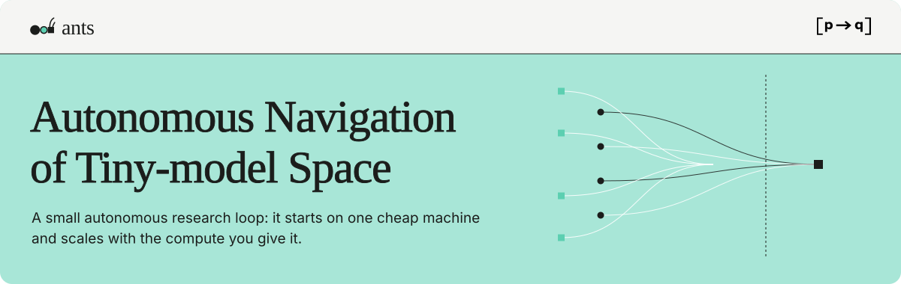
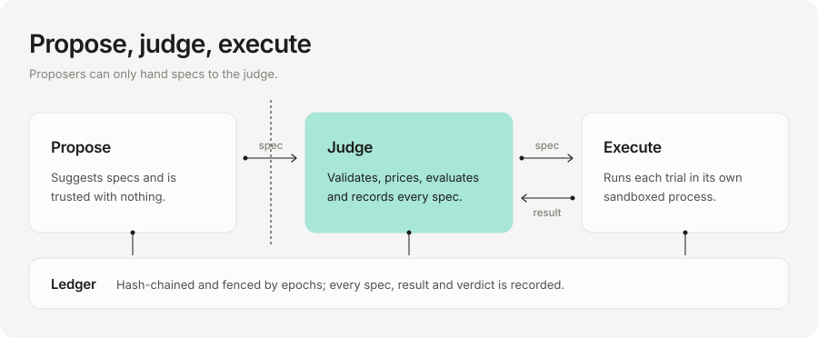
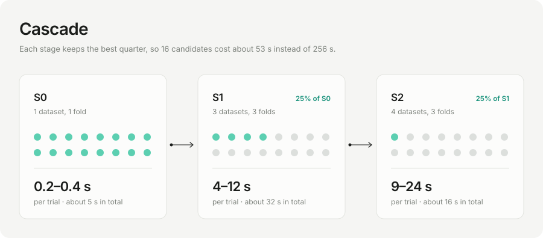
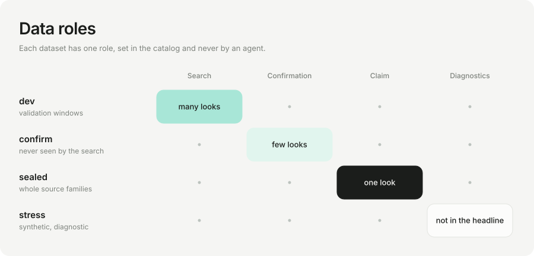
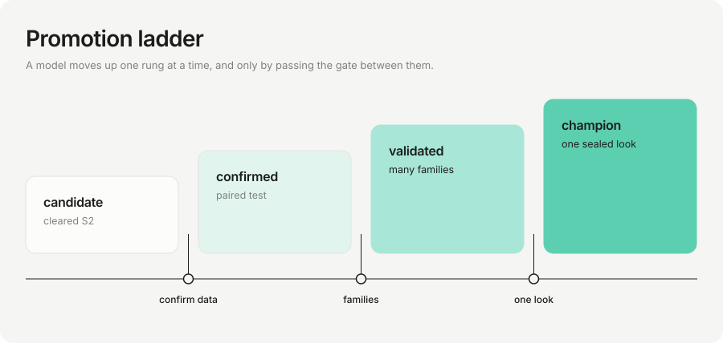
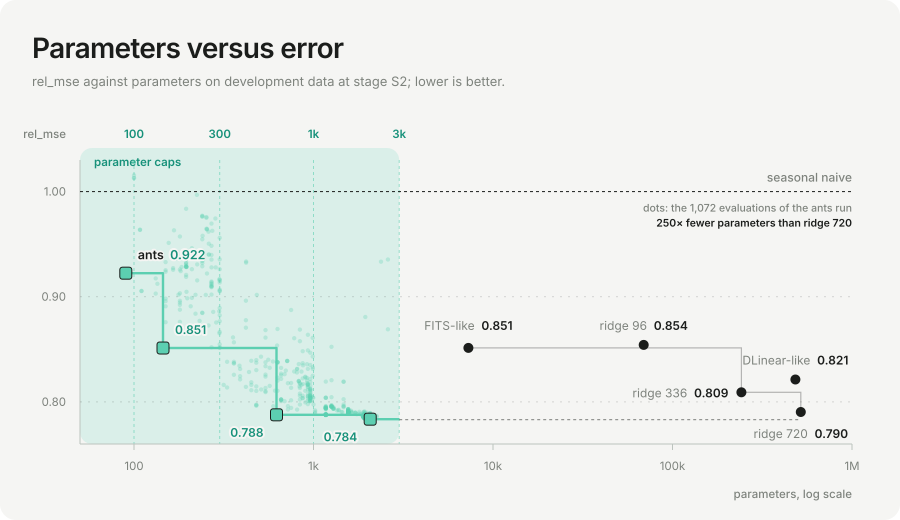
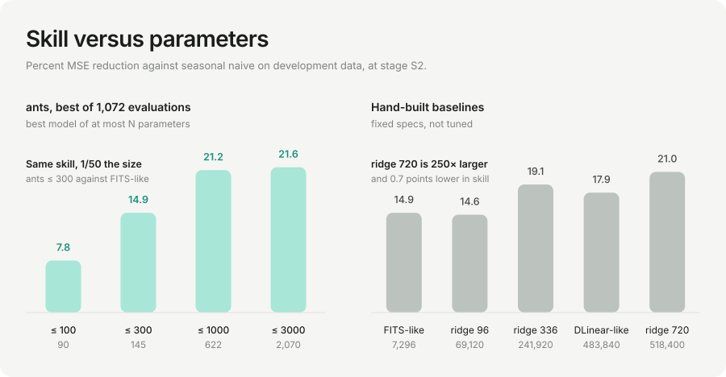
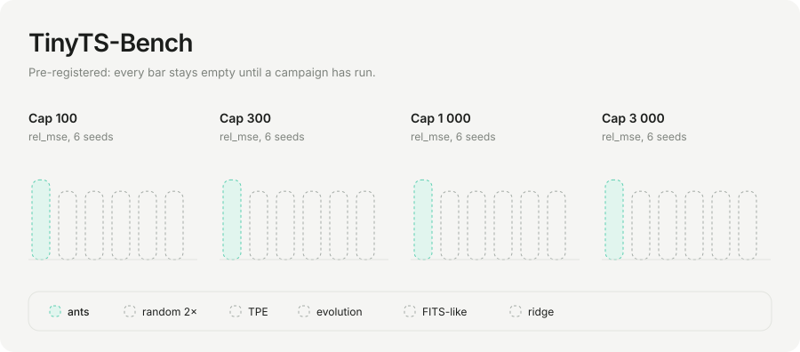

<p align="center"></p>

<p align="center">
<a href="./.github/workflows/ci.yml"></a>
<a href="./LICENSE"></a>
<a href="./pyproject.toml"></a>
<a href="./docs/surfaces.md"></a>
<a href="https://www.npmjs.com/package/ants-lab"></a>
</p>

<p align="center">
<a href="#start-here">Start here</a> · <a href="#news">News</a> · <a href="#how-it-works">How it works</a> · <a href="#first-measurement">Measurement</a> · <a href="#install">Install</a> · <a href="#quick-start">Quick start</a> · <a href="#documentation">Documentation</a> · <a href="#roadmap">Roadmap</a> · <a href="#cite">Cite</a>
</p>

**A small autonomous research loop: it starts on one cheap machine and scales with the compute you give it.**

> I believe a leaf of grass is no less than the journey-work of the stars,
> And the pismire is equally perfect, and a grain of sand, and the egg of the wren.
> — Walt Whitman, *Song of Myself*, §31

A pismire is an ant: no plan, no view of the whole, a trace left for others. ants works the same way. Many small, cheap,
fallible searchers (scripts, search operators, small language models) move through a space of candidate models, and none of them
scores its own work: a fixed evaluator does, and nothing a searcher writes can reach it.

It runs unattended on a 2 vCPU / 2 GB machine, and the same loop grows with the compute you give it ([scaling](docs/scaling.md)).
The first domain is time-series forecasting with models of 100 to 3 000 parameters; the loop does not care what the models are.

<p align="center"></p>

## Start here

| I want to | go to |
|---|---|
| see it run | [Quick start](#quick-start) |
| know what ants holds true | [principles](docs/principles.md) |
| see what runs, and how far to trust it | [surfaces](docs/surfaces.md) |
| understand the parts and the words | [architecture](docs/architecture.md) · [glossary](docs/glossary.md) |
| write a gym or a contract | [gyms](docs/gyms.md) · [contracts](docs/contracts.md) |
| use the CLI, or drive it from an agent | [cli](docs/cli.md) · [AGENTS.md](AGENTS.md) |
| run it for weeks on a small server | [operations](docs/operations.md) |
| see the protocol and what is still unknown | [benchmark](docs/benchmark.md) · [open questions](docs/open.md) |
| change something | [CONTRIBUTING](CONTRIBUTING.md) · [changes](docs/changes.md) |

## News

| date | |
|---|---|
| 2026-10-13 | Independent audit: 36 findings. Single-instance lock, signal-safe shutdown, an AST patch gate, sealed-look accounting, chain anchors and per-bin promotion evidence are merged. |
| 2026-10-13 | `ants best` now ranks by the deepest stage reached; the first-stage value no longer outranks a deeper one. |
| 2026-10-13 | Cheap-stage fidelity measured: S0 keeps only half of the true top quartile; S1 and S2 agree almost exactly ([open questions](docs/open.md)). |
| 2026-10-13 | TinyTS-Bench protocol written down before any run ([benchmark](docs/benchmark.md)). |

## Look

```
ants tinyts_real · arm portfolio · epoch 9a60d4a9ac35 · chain ok 2de7693a5a93

best per parameter cap (deepest stage reached)
  ≤  300  0.8922 s2  300 params   evo    lookback=248, norm=last, augment=True
  ≤ 1000  0.8706 s2  420 params   sweep  norm=last
  ≤ 3000  0.8460 s2  1190 params  evo    lookback=352, period=22, norm=last, ens=3, ...

search mechanisms (discovery rate)  qd 1.00  sweep 0.67  tpe 0.33  evo 0.25  sa 0.00  de 0.00
```

`ants top` on a 60-trial demo, not a campaign. `rel_mse` below 1 beats seasonal naive. Plain `ants` on a terminal opens the [terminal interface](docs/tui.md).

## How it works

<p align="center"></p>
<p align="center"></p>
<p align="center"></p>

| | most agentic research loops | ants |
|---|---|---|
| who judges | the proposer, or a prompt | code the proposers cannot reach |
| limits | a term in the objective | a constraint on the search: over-limit models never lead |
| language models | the engine | one cheap operator, tested against random search at equal budget |
| failure | an exception | a normal outcome: `kill -9`, full disk, clock jumps |

The eight evaluation layers: [docs/evaluation](docs/evaluation/README.md).

## First measurement

<p align="center"></p>
<p align="center"></p>

Same protocol for every bar: stage S2 (four development datasets, rolling origin, closed-form models). Baselines are hand-built and
untuned; ants is the best of 60 trials chosen on the same validation data, so this is **not a claim**. No sealed data was touched.
Data: [frontier.json](assets/frontier.json). Regenerate: `python assets/measure_frontier.py && python assets/make_figures.py`.

## Benchmark

<p align="center"></p>

**TinyTS-Bench** is specified before it is run: arms, seeds, stopping rule and what counts as a null result are in the
[protocol](docs/benchmark.md).

## Install

| how | command | notes |
|---|---|---|
| npm, installed | `npm install -g ants-lab`, then `ants` | the package is a thin launcher; on first run it builds a private Python environment in `~/.ants` (Python 3.11+ and network needed, about ten seconds) |
| npm, no install | `npx ants-lab doctor` | same launcher, run once |
| from source | `git clone https://github.com/p-to-q/ants` then the steps in [Quick start](#quick-start) | for development, and for real data runs that live in the checkout |

The npm package is [`ants-lab`](https://www.npmjs.com/package/ants-lab) (the bare name `ants` is taken). The command it installs is `ants`.
Versions and how a release is cut: [docs/release.md](docs/release.md). PyPI: not published yet.

## Quick start

**1. Install**

```bash
npm install -g ants-lab                  # or: git clone https://github.com/p-to-q/ants && cd ants && uv pip install -e ".[gyms,search,dev]"
```

**2. Set up**: creates `~/.ants`, downloads the public datasets (every file checked against a pinned hash) and writes the config

```bash
ants onboard
```

**3. Run**

```bash
ants run                                 # in the foreground
ants service install --now               # or keep it running: restarts, watchdog, daily verified backup
ants run --contract tinyts_synth_hard --workdir runs/demo --max-evals 300      # a first look on synthetic data
```

**4. Look at it**

```bash
ants                  # on a terminal: the interface (docs/tui.md); in a pipe: the line shell
ants top              # state, best per cap, operators
ants show 12          # spec, every stage, lineage of one trial
ants diff 5 7         # what differs between two trials
ants sql "SELECT stage, COUNT(*) FROM trials GROUP BY stage"     # read-only
ants doctor           # hash chain, disk, stuck or failing runs, backups
ants backup           # verified snapshot; ants restore puts one back
```

Every read command has `--json` and meaningful exit codes, so another agent can drive the same surface ([AGENTS.md](AGENTS.md)).

**5. Language-model arms** (optional): put `LLM_<TAG>_BASE`, `LLM_<TAG>_KEY` and `LLM_<TAG>_MODEL` in a `chmod 600` env file and use `--arm portfolio_llm`, or `--arm portfolio_agent` for the operator that reads the ledger before it proposes. Keys are never written to the repository, the ledger or a log; model calls are capped per day.

**6. A server**: [operations](docs/operations.md) and `deploy/`. `ants update` checks for a newer version.

## Documentation

| | |
|---|---|
| [Principles](docs/principles.md) | what ants holds true, and where each is enforced |
| [Architecture](docs/architecture.md) · [Glossary](docs/glossary.md) | the parts and the words |
| [Evaluation layers](docs/evaluation/README.md) | eight layers, one question each |
| [Modules](docs/modules/README.md) | one page per module |
| [Contracts](docs/contracts.md) · [Gyms](docs/gyms.md) | add a task domain |
| [CLI](docs/cli.md) | every command, flag and exit code |
| [Operations](docs/operations.md) · [Scaling](docs/scaling.md) | install, limits, failure modes, budget; what grows by configuration |
| [Benchmark](docs/benchmark.md) · [Open questions](docs/open.md) · [FAQ](docs/faq.md) | protocol, unknowns, objections |
| [Terminal interface](docs/tui.md) | the screens, keys and design of what `ants` opens |
| [Meta-Harness study](docs/research/meta-harness.md) | what the paper and its neighbours show, and what ants takes from them |
| [Data](docs/DATA.md) · [Security](SECURITY.md) · [Surfaces](docs/surfaces.md) | datasets, threat model, what is stable |

## Verification

| claim | checked by |
|---|---|
| a run survives `kill -9` at random moments | `pytest -m slow` |
| a stale writer cannot overwrite a newer attempt; tampering with the record is detected | `tests/test_ledger_gate.py` |
| a cap is enforced per bin | `tests/test_percap.py` · `tests/test_campaign.py` |
| negative controls show no skill | `tests/test_synth_suite.py` |
| the search loop needs only the standard library | `tests/test_audit_regressions.py` |
| proposer output enters only through the typed grammar | `tests/test_llm_proposers.py` |

Weaker spots are listed in [surfaces](docs/surfaces.md). An independent audit found 36 issues; their status is in [changes](docs/changes.md).

## Requirements

Python 3.12 (3.11 works for the loop). The search loop uses only the standard library; statistics, data and gyms need numpy.

| extra | packages | status |
|---|---|---|
| `gyms` | numpy | used |
| `search` | optuna | used |
| `ops` | certifi | used |
| `dev` | pytest | used |
| `s3` · `artifact` · `export` · `ml` · `nn` | boto3 · onnx · pyarrow · scikit-learn · torch | stub or planned |

Hashed locks: `requirements/`. Ubuntu 24.04 and macOS are tested.

## Roadmap

- [x] ledger, runner, campaign, search ecology, interactive shell, janitor
- [x] sealed-look accounting, chain anchors, promotion ladder with evidence
- [x] pre-registered benchmark protocol
- [ ] first long campaign on a 2 GB server
- [ ] equal-budget comparison: ants against random 2× and TPE, at least 6 seeds
- [ ] stronger cheap stage (see [open questions](docs/open.md))
- [ ] artifact checks (E3), per-window losses for the registry
- [ ] a worker pool per arm, for larger machines ([scaling](docs/scaling.md))
- [ ] a second arena: one frozen model, many datasets

## Contributing

Small, reviewable changes that keep the evaluator out of reach of what it evaluates. Start with [CONTRIBUTING](CONTRIBUTING.md); security issues go to the address in [SECURITY](SECURITY.md).

## Acknowledgements

DLinear, FITS and SparseTSF for the ultra-light forecasting line; SearchCast for the ridge baseline we must beat; AlphaEvolve, OpenEvolve and ShinkaEvolve for LLM-guided evolutionary search; MAP-Elites; Thresholdout and the Ladder; fev-bench. Baselines are re-run here; published numbers are never imported.

## License

Code Apache-2.0 ([LICENSE](LICENSE), [NOTICE](NOTICE)). Documentation CC-BY-4.0. Datasets keep their own licences.

## Cite

```bibtex
@software{ants2026,
  title  = {ants: Autonomous Navigation of Tiny-model Space},
  author = {{[p → q]}},
  year   = {2026},
  url    = {https://github.com/p-to-q/ants}
}
```

<p align="center"><sub>Q.E.D., when the ledger says so.</sub></p>
