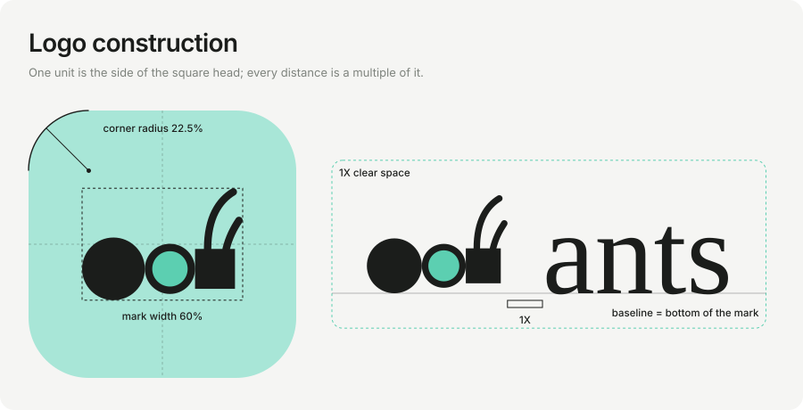

# ants logo

The mark is an ant of three parts that touch edge to edge: two circles (the ants) and a square head (the one fixed thing), with two antennae.
Every number below is generated by [`../make_logo.py`](../make_logo.py) and checked by `tests/test_assets.py`.

## Files

| file | what | text | background |
|---|---|---|---|
| [`mark.svg`](mark.svg) | the mark | no | transparent |
| [`tile.svg`](tile.svg) | the mark centred on a mint tile; avatar, app icon | no | mint, rounded |
| [`tile-dark.svg`](tile-dark.svg) | the same on ink, for dark surfaces | no | ink, rounded |
| [`wordmark.svg`](wordmark.svg) | the mark and the name side by side | yes | transparent |
| [`wordmark-plate.svg`](wordmark-plate.svg) | the lockup centred on a light plate | yes | paper, rounded |

## Measurements

One unit **X** is the side of the square head (14 design units). Everything else is a multiple of it or a percentage.

| what | value |
|---|---|
| mark body | 56.3 × 39.3 units, antennae included; always centred on its bounding box |
| clear space | 1 X on every side (mark and wordmark files carry it in their viewBox) |
| tile: corner radius | **22.5 %** of the side (115.2 on the 512 tile) |
| tile: mark width | **60 %** of the side, centred horizontally and vertically |
| lockup: gap between mark and name | **1 X** |
| lockup: name baseline | the bottom of the mark |
| lockup: name size | 1.2 × the mark height; the name is pinned to 1.60 em wide so every fallback font gives the same layout |
| plate: padding | **2 X** on every side, lockup centred |
| plate: corner radius | **22.5 %** of the plate height |
| minimum size | mark 16 px (reads as a silhouette), tile 32 px, wordmark 96 px wide |

## Colour and type

| role | value |
|---|---|
| ink | `#1b1d1b` |
| paper | `#f5f5f3` |
| mint (tile) | `#a8e6d7` |
| mint (thorax) | `#5ccfb1` |
| name | Martina Plantijn when installed, then Plantin, Crimson, Source Serif, Georgia; Medium |

Martina Plantijn is a commercial typeface and is not embedded. With a licence, convert the name to outlines for a version that renders the same everywhere.

## Do not

- stretch, rotate or recolour the parts; change the order of the three parts
- put the mark on a busy image without the tile
- draw the antennae thicker or add legs: at 16 px the mark has to stay a clean silhouette
