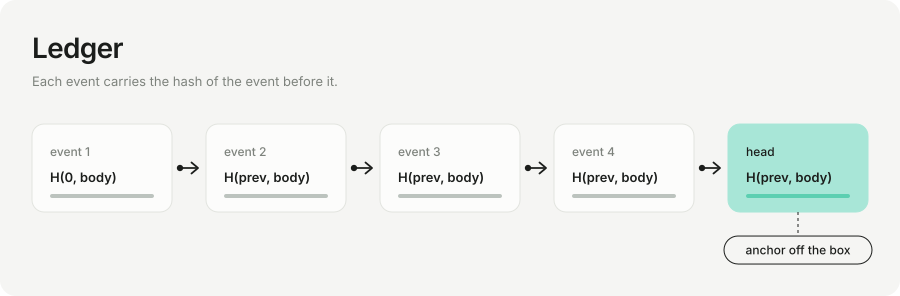

# ledger

SQLite single source of truth: trials, artifacts, sealed-evaluation credits, LLM-call log, hash-chained events.

**Interface**
- Trial life cycle: `enqueue`, `claim(lease_s, gym, arm, epoch=)`, `finish`, `requeue`, `reclaim_stale(max_attempts, all_running=)`. `attempt` is a fencing token. `claim` stamps the epoch of the process that RUNS the trial (a trial queued before an evaluator change and run after it belongs to the new epoch).
- Aggregates for the hot loop: `count_final`, `recent_final` (ordered by `finished_at DESC, id DESC`), `seen_keys(gym, arm, epoch=None)` (with `epoch`, only specs measured by that epoch), `cpu_total`, `register_epoch`.
- Audit stream: `event` (refuses `RESERVED_KINDS`), `_emit`, `head`, `verify_chain(upto=)`, `verify_tail(n)`, `recent_events`, `events`. Every finished trial writes ONE `trial_finished` event with the full record (queued/running are transient).
- External anchor: `anchor()` -> `Anchor(seq, head, ts)`, `verify_against_anchor`, `write_anchor(path)` (append + fsync), `verify_anchor_file(path)`.
- Files: `add_artifact`, `mark_archived`, `mark_deleted`, `set_protected`, `artifact(s)`.
- Evidence gate: `freeze(gym, candidate, fingerprint, evidence, epoch=, protocol=)`, `frozen`, `is_frozen`, `record_unseal(..., sealed_set, lifetime)`, `record_sealed_result`, `sealed_result`, `unseal_count`.
- Judge log and LLM-call log: `log_judgement`, `resolve_judgement`, `judgements`, `log_llm`, `llm_calls_since`.

**Invariants**
- All state changes and their event are one `BEGIN IMMEDIATE` transaction. `tx()` rolls back on any failure, including a failed `COMMIT`, and never masks the original error, so one transient `database is locked` cannot wedge every later transaction.
- `finish` succeeds only for the current attempt of a running trial.
- Event `ts` (and `finished_at`) are never earlier than the newest event (`_stamp`): a clock stepped backwards cannot reorder history that `History` and the breaker tail by time.
- `canon()` refuses NaN/Infinity (`allow_nan=False`).
- `verify_chain` checks links, hashes and contiguous `seq`. `verify_tail` also links its first row to its predecessor.
- Credits: one look per freeze hash independently of sealed-set strings, including legacy freezes without an epoch; `unseal_limit` looks per (gym, epoch, sealed set); `unseal_lifetime` per (gym, sealed set) over all epochs; limits only ratchet down; looks are counted as the max of the `unseals` table and the hash-chained `sealed_evaluation` events; `record_sealed_result` writes exactly one result per look and none without a look. Rules are in [E7](../evaluation/E7-claim.md).
- `freeze` refuses evidence whose trial is missing, from another gym, has a different spec, or comes from an epoch whose code fingerprint differs from the one being frozen.

**Notes / failure behaviour**
- The hash is unkeyed. Tail truncation, or a consistent rewrite from any point, is detected only against an anchor kept off-box. No CLI command, daemon or deploy unit writes anchors today; only `gate.seal(..., anchor_file=)` does.
- Mutable tables outside the chain drive decisions: `trials.metrics` (ranking, `freeze_best`), `artifacts`, `unseals`, `models`. `unseals` is cross-checked against events; `models` by `Registry.verify()`. Nothing audits `trials` against the `trial_finished` events (E0 gap).
- `unseals` got `epoch` and `sealed_set` columns, migrated in place on open, plus a unique index; a ledger with legacy duplicate rows keeps working because `record_unseal` refuses a second look in code.
- `synchronous=FULL`, WAL. The event log grows without bound; the supervisor must not run under a per-file size limit (`LimitFSIZE` applies to `ledger.sqlite` and its WAL; the unit file `deploy/ants@.service` omits it for that reason).
